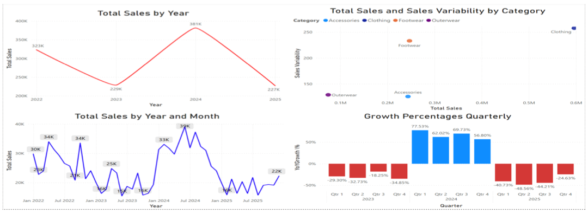
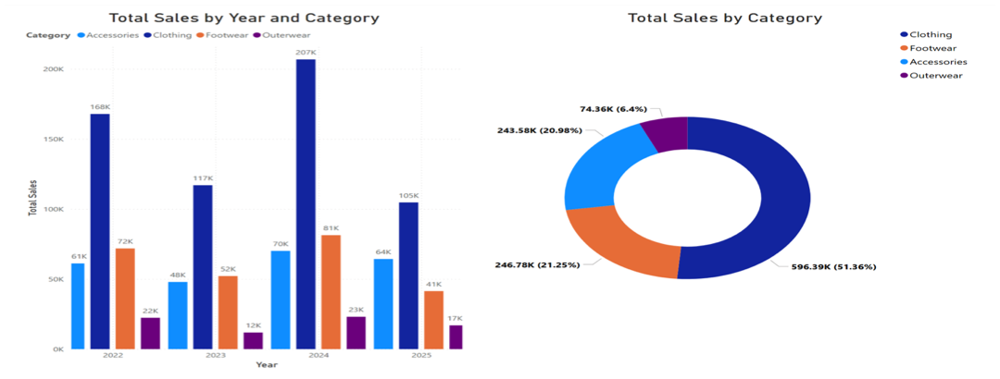
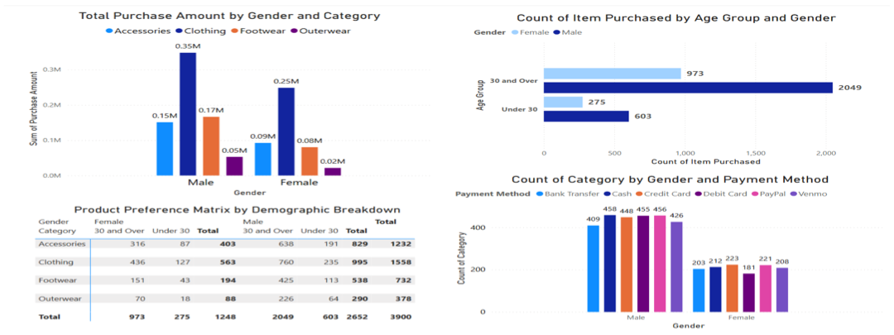

<div align="center">

# 🛍️ Retail Sales & Customer Analytics
### Sales Variability, Category Growth & Customer Demographics (2022–2025)


</div>

---

## 📌 Business Problem

A fashion retailer wants to understand **how stable its sales are**, **which product categories drive growth**, and **who its customers are**, so it can manage risk and target the right segments.

## 🎯 Key Insights at a Glance

| | Insight |
|---|---|
| 💰 **~$1.16M** | Total sales across **3,900 transactions** (2022–2025) |
| 👕 **51.4%** | Share of revenue from **Clothing**, so the business depends heavily on one category |
| 📈 **+77.5%** | Highest quarterly YoY growth (**Q1 2024**) |
| 📉 **Up to −49%** | YoY quarterly declines in 2025, the volatility the business needs to manage |
| 👨 **Male, 30+** | Largest customer segment (2,049 items purchased) |

## 📊 Dashboard & Analysis

### 1. Sales & Variability Analysis


- Yearly sales swing sharply: **$323K → $229K → $381K → $227K**.
- The **risk–return scatter** (total sales vs. variability) shows **Clothing** as high-volume but highly volatile, while **Outerwear** and **Accessories** are stable performers.
- The biggest single month was **June 2024**, and the strongest growth quarter was **Q1 2024**, driven by the Oct 2023 – Feb 2024 rally.

### 2. Sales Distribution by Category


- **Clothing** is the all-time leader by a wide margin ($596K, 51.4%), followed by Footwear (21.3%), Accessories (21.0%) and Outerwear (6.4%).
- Even a small change in clothing sales moves total revenue, which is a **concentration risk**.

### 3. Customer Demographics


- **Males** generate the most revenue, especially in Clothing ($0.35M).
- Customers **aged 30 and over** dominate purchases for both genders.
- **Payment behavior differs by gender**: men lean towards *cash and debit card*, while women prefer *credit card and PayPal*.

## 💡 Business Recommendations

1. **Diversify revenue** by growing the stable Footwear and Accessories lines to reduce dependence on volatile Clothing sales.
2. **Target the under-30 segment**, which is clearly underpenetrated, with digital campaigns.
3. **Tailor checkout and promotions by payment preference**, for example PayPal or credit card offers for female shoppers.
4. **Plan inventory around seasonality**, using the Q1/Q2 peaks seen in 2024.

## 🗂️ Dataset

3,900 transactions × 20 features, including age, gender, item, category, US state, size, color, season, review rating, subscription status, shipping type, discount and promo usage, previous purchases, payment method, purchase frequency, purchase date and purchase amount.

## 📁 Repository Structure

```
├── dashboard/   retail-sales-dashboard.pbix   → Interactive Power BI dashboard
├── report/      retail-sales-report.pdf       → Infographic & written analysis
├── data/        retail-sales-dataset.csv      → Raw dataset (3,900 rows)
└── images/                                    → Visuals used in this README
```

## 🚀 How to Explore

1. Download [`dashboard/retail-sales-dashboard.pbix`](dashboard/retail-sales-dashboard.pbix) and open it with **[Power BI Desktop](https://powerbi.microsoft.com/desktop/)** (free).
2. Or read the [📄 PDF report](report/retail-sales-report.pdf).

## 🛠️ Skills Demonstrated

`Time-Series Trend Analysis` · `YoY / QoQ Growth Metrics` · `Risk–Return (Variability) Analysis` · `Customer Segmentation` · `DAX Measures` · `Data Storytelling` · `Power BI`

---

<div align="center">

👤 **Yasin Topal** · Master of Data Analytics portfolio project

⭐ If you found this project interesting, consider giving it a star!

</div>
